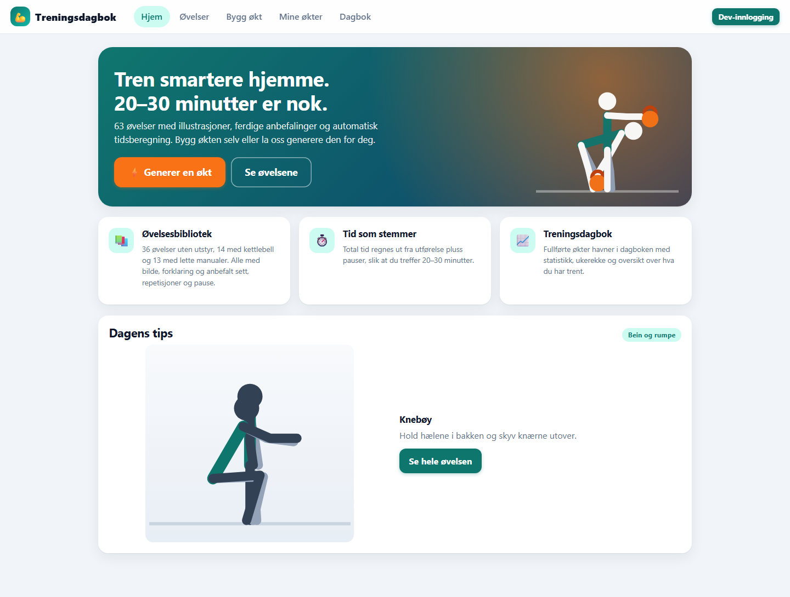
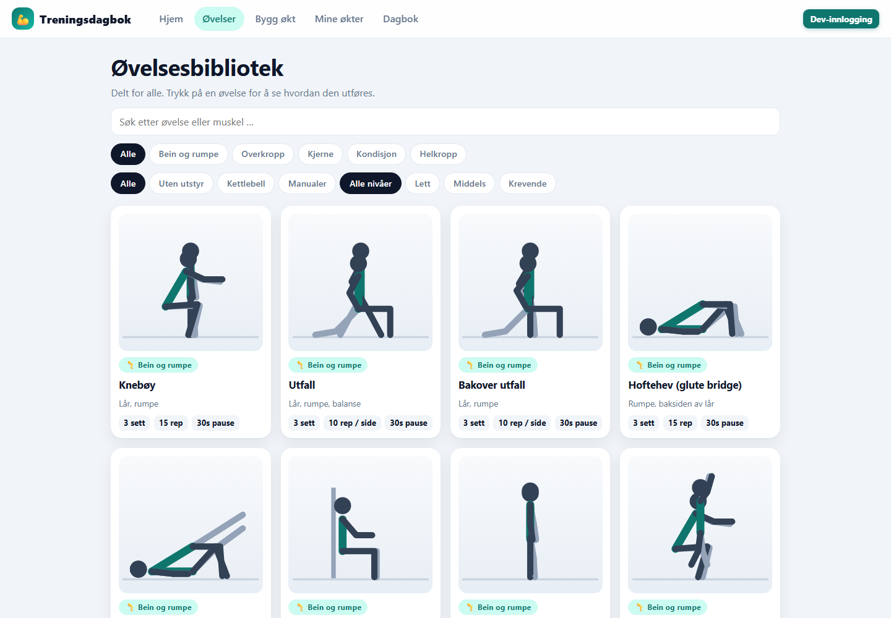
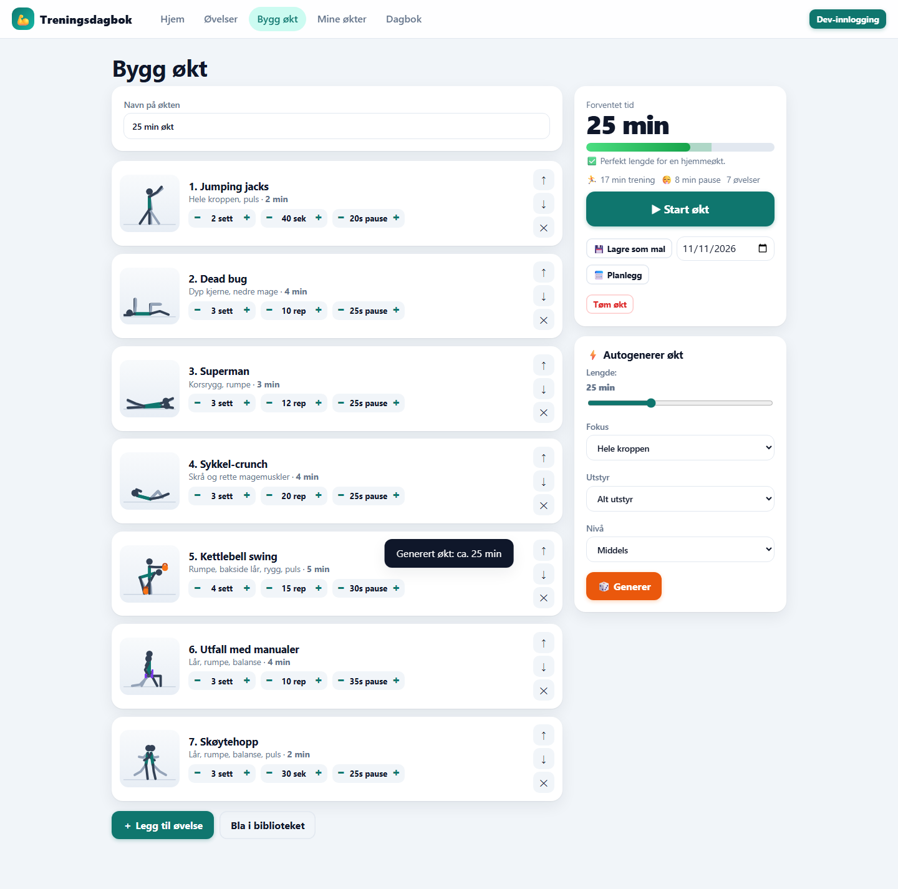

# Treningsdagbok

Treningsdagbok + øvelsesbibliotek + øktplanlegger. ASP.NET Core (.NET 10) minimal API som også serverer frontend (vanilla JS/CSS i `wwwroot`, ingen byggesteg).

## Funksjoner
- **Øvelsesbibliotek** (delt for alle): 63 øvelser (36 uten utstyr, 14 med kettlebell og 13 med manualer) med animert strekfigur-illustrasjon, forklaring og anbefalt sett/reps/pause.
- **Bygg økt**: legg til øvelser, juster sett/reps/pause, eller autogenerer (lengde, fokus, utstyr, nivå). Total tid = utførelse + pauser + 20 s mellom øvelser, med måler for 20–30 min.
- **Kjør økt**: guidet visning med nedtelling, pauser og lyd.
- **Planlegg / lagre maler** (krever innlogging).
- **Kroppsvekt**: registrer vekt og sett vektmål i dagboken; graf, endring og avstand til målet.
- **Trene sammen**: ved start av økt kan du legge til andre brukere via e-post (de må ha logget inn før). Økten og statistikken havner også i deres dagbok.
- **Dagbok**: ukemål, ukerekke, total tid, snitt/lengste økt, reps/sett, ukentlig tid, ukedager, muskelgrupper, topp-øvelser, 12-ukers heatmap og historikk.

## Kjør lokalt

Krever .NET 10 SDK og NuGet-tilgang ved første bygg. Fra en fersk klone:

```powershell
Copy-Item appsettings.example.json appsettings.json
dotnet run
```
Åpne http://localhost:5196. I Development finnes «Dev-innlogging» så du kan teste uten Google.

## Eksempelbilder

Bildene er fra en separat lokal database uten brukerens treningshistorikk eller Google-innlogging.







## Google-innlogging
1. Google Cloud Console → APIs & Services → Credentials → OAuth client ID (Web).
2. Authorized redirect URI: `https://<din-app>.azurewebsites.net/signin-google` (lokalt: `http://localhost:5196/signin-google`).
3. Sett hemmelighetene:
   - Lokalt: `dotnet user-secrets init; dotnet user-secrets set "Authentication:Google:ClientId" "..."; dotnet user-secrets set "Authentication:Google:ClientSecret" "..."`
   - Azure App Service → Environment variables: `Authentication__Google__ClientId`, `Authentication__Google__ClientSecret`.

## Konfigurasjon (`appsettings.json`)
- `Authentication:Google:ClientId` / `ClientSecret` – Google-innlogging (tom = deaktivert). Legg ekte verdier i user-secrets eller Azure-miljøvariabler, ikke i git.
- `Database:Directory` – mappe for SQLite-filen (tom = `App_Data`, eller `/home/data` på Azure).
- `App:WeeklyGoal` – ukemål for antall økter (standard 3).

Kun den rensede `appsettings.example.json` ligger i Git. `appsettings.json`, utviklingskonfigurasjon, databaser, `App_Data/` og Visual Studio-publiseringsprofiler utelates. Lokale filer beholdes på maskinen. Bruk egne hemmeligheter ved installasjon; eksempelkonfigurasjonen aktiverer ikke Google-innlogging.

## Bygg og verifisering

```powershell
dotnet build TreningsDagbok.csproj -c Release
```

Bygg og lokal visning av forsiden, øvelsesbiblioteket og autogenerering av økt er kontrollert 11. november 2026 med separat database og uten Google-innlogging. Prosjektet har ingen separat automatisk testpakke. Ekte Google-innlogging og Azure-deploy inngår ikke i denne kontrollen.

## Azure
```
az group create -n trening-rg -l westeurope
az appservice plan create -g trening-rg -n trening-plan --sku B1 --is-linux
az webapp create -g trening-rg -p trening-plan -n <unikt-navn> --runtime "DOTNET|10.0"
dotnet publish -c Release -o publish
Compress-Archive publish\* publish.zip -Force
az webapp deploy -g trening-rg -n <unikt-navn> --src-path publish.zip --type zip
```
Data lagres i SQLite under `/home/data/trening.db` (persistent på App Service). For flere instanser/skalering: bytt til Azure SQL ved å endre `UseSqlite` i `Program.cs` til `UseSqlServer`.
